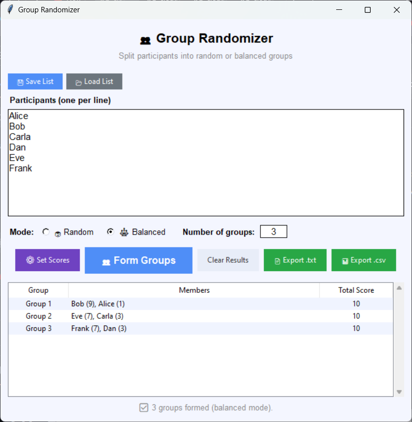

# 👥 Group Randomizer

A simple desktop app that splits a list of people into groups. Shuffle them completely at random, or give everyone a score and let the app build groups of equal strength.



**Links:** [Project page](https://cloudbv.github.io/group_randomizer_balanced/) · [Download on itch.io](https://cloudbv.itch.io/group-randomizer-with-score-system-for-balance)

## Features

- 🎲 **Random mode:** shuffles the list and deals people into groups, so group sizes differ by at most one person.
- ⚖️ **Balanced mode:** give each person a score from 1 to 10, and every group ends up with a similar total score.
- ⚙️ **Score editor:** a pop-up with a 1–10 spinbox for each person. Scores are remembered when you switch modes.
- 💾 **Save and load:** store your participant list and scores as a JSON file.
- 📄 **Export:** save results as `.txt` or `.csv` (opens in Excel or Google Sheets).
- ✅ **Input checks:** warns about invalid group counts, more groups than people, and missing scores (default is 5).

## How balanced mode works

Balanced mode uses a **snake draft**, the same idea sports leagues use to keep teams even.

1. People are shuffled, then sorted by score from highest to lowest (the shuffle keeps ties random).
2. Round 1 gives one person to each group in order: Group 1, 2, 3...
3. Round 2 goes in reverse: ...3, 2, 1. The direction flips every round.

Example with three groups:

| Round | Group 1   | Group 2   | Group 3   |
|-------|-----------|-----------|-----------|
| 1     | Bob (9)   | Eve (7)   | Frank (7) |
| 2     | Alice (1) | Carla (3) | Dan (3)   |
| Total | **10**    | **10**    | **10**    |

Clicking **Form Groups** again gives a fresh result that is still balanced.

## Getting started

### Option 1: Download

Get the ready-to-use version from [itch.io](https://cloudbv.itch.io/group-randomizer-with-score-system-for-balance).

### Option 2: Run from source

You need Python 3 with Tkinter, which is included in most Python installers for Windows and macOS. There are no other dependencies.

```bash
git clone https://github.com/cloudbv/group_randomizer_balanced.git
cd group_randomizer_balanced
python3 group_randomizer.py
```

## Usage

1. Type or paste your participants, one name per line.
2. Choose **Random** or **Balanced** mode.
3. Enter the number of groups.
4. In balanced mode, click **Set Scores** and give each person a score from 1 to 10.
5. Click **Form Groups**.
6. Export the results with **Export .txt** or **Export .csv**.

## Save file format

Saved lists are plain JSON, so you can also edit them by hand. Scores are only used in balanced mode.

```json
{
  "participants": ["Alice", "Bob", "Carla"],
  "scores": { "Alice": 8, "Bob": 5, "Carla": 6 }
}
```

## Built with

Python 3 and Tkinter (standard library only).

## Author

Made by [CloudBV](https://cloudbv.itch.io/).
